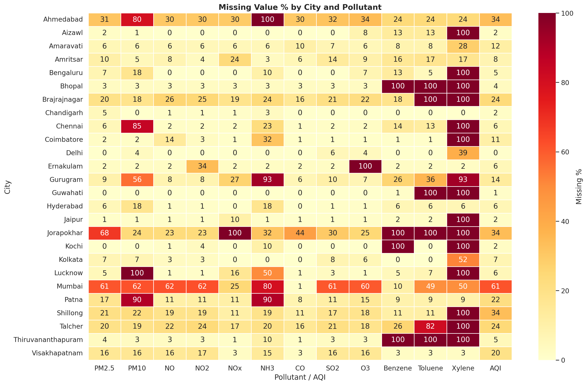
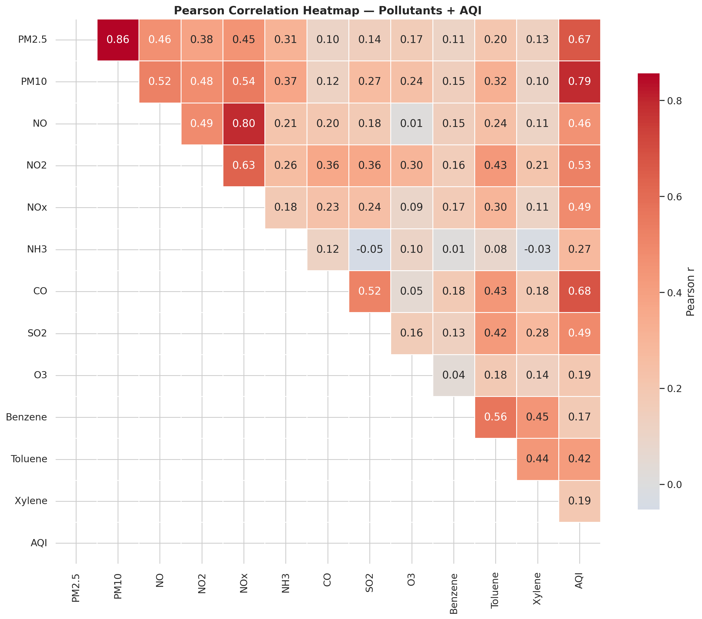
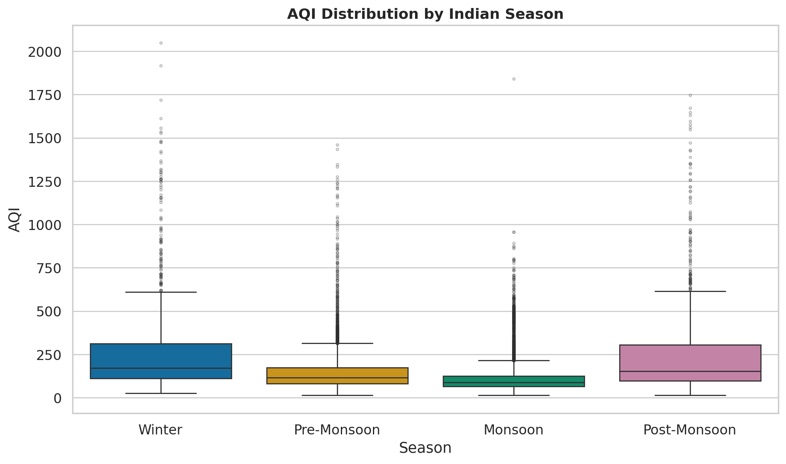
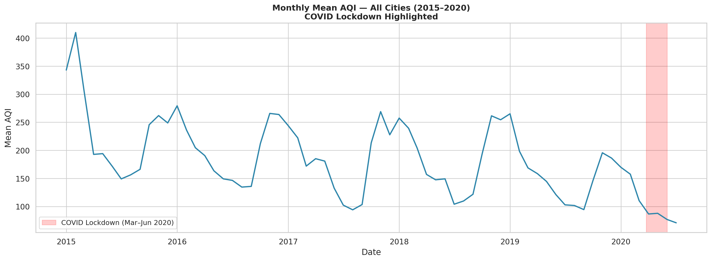
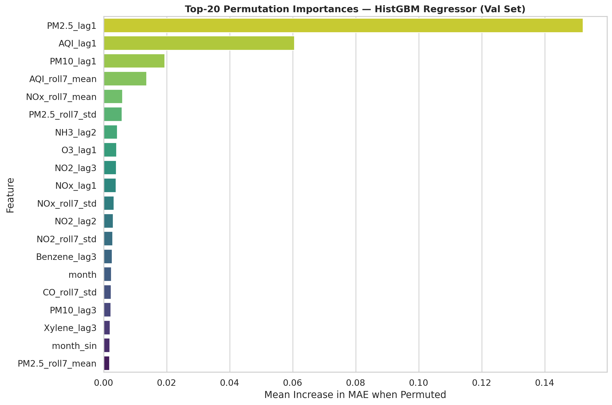
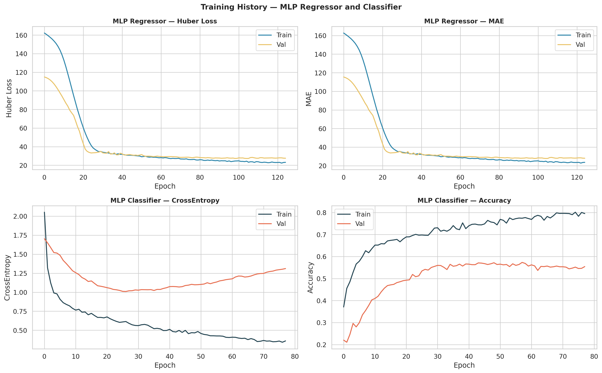
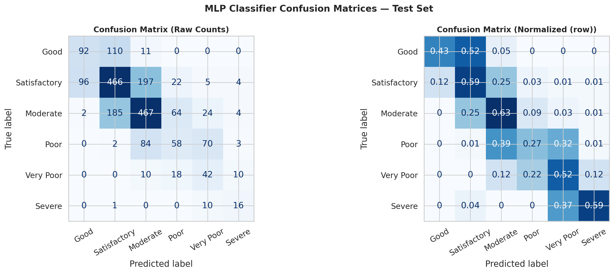
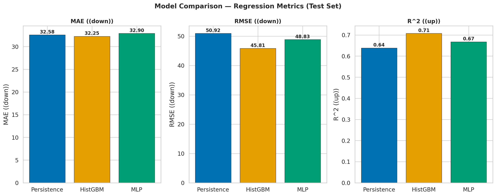

# Exploratory Data Analysis and Next-Day Air Quality Prediction for Indian Cities

This project analyzes daily air quality measurements across Indian cities and builds next-day AQI regression and AQI-category classification models. It includes data preparation, statistical analysis, static and interactive visualizations, model evaluation, and a report-generation workflow.

## Project at a glance

- **Dataset:** CPCB city-level air-quality data distributed through Kaggle (`city_day.csv`).
- **Coverage:** 29,531 source rows, 16 columns, 26 cities, 2015-01-01 to 2020-07-01.
- **Targets:** Next-day AQI (regression) and next-day AQI category (six-class classification).
- **Model inputs:** 92 engineered features.
- **Deep learning model:** Keras feed-forward Multilayer Perceptron (MLP).
- **Visualization:** Python, using Matplotlib, Seaborn, and Plotly.
- **Reproducibility:** NumPy, Python, and TensorFlow random seeds are set to 42.

## Repository contents

| Path | Purpose |
|---|---|
| `notebooks/aqi_eda_model.ipynb` | Annotated, interactive Jupyter notebook for the complete analysis. |
| `src/aqi_eda_model.py` | Script version of the end-to-end data analysis and modeling pipeline. |
| `data/city_day.csv` | Input dataset; download separately because the raw file is not committed. |
| `data/README.md` | Dataset source, schema, and placement instructions. |
| `figures/` | Generated static charts and interactive Plotly HTML visualizations. |
| `results.json` | Metrics and summary statistics generated by the analysis script. |
| `generate_report.py` | Creates the formatted Word report from `results.json` and available figures. |
| `report/Project_Report.docx` | Generated project report (may need regeneration after rerunning the analysis). |
| `requirements.txt` | Python dependencies used by the project. |

## Research questions and objectives

1. What are the distributions, missingness patterns, and relationships among pollutant concentrations and AQI?
2. How do AQI levels vary by city, season, month, and weekday, and how did AQI change during the 2020 COVID-19 lockdown period?
3. Can historical pollutant, AQI, calendar, and city information predict next-day AQI and its category?
4. How does the MLP compare with persistence and Histogram Gradient Boosting (HistGBM) baselines?

The analysis follows Ben Fry's visualization workflow: acquire, parse, filter, mine, represent, refine, and interact.

## Dataset

The source is the [Air Quality Data in India dataset on Kaggle](https://www.kaggle.com/datasets/rohanrao/air-quality-data-in-india), based on measurements from India's Central Pollution Control Board (CPCB). The project uses `city_day.csv`, containing city and date identifiers, 12 pollutant measurements, AQI, and `AQI_Bucket`.

The raw CSV is intentionally excluded from the repository. Download it from Kaggle and put it here:

```text
data/city_day.csv
```

See [`data/README.md`](data/README.md) for the column schema and additional dataset notes.

## Setup and run

Use Python 3.10 or 3.11 and run commands from the repository root.

```bash
python -m venv .venv
# Windows PowerShell:
.venv\Scripts\Activate.ps1
# macOS/Linux:
source .venv/bin/activate

python -m pip install --upgrade pip
python -m pip install -r requirements.txt
```

After placing `data/city_day.csv` in the expected location, run the full pipeline:

```bash
python src/aqi_eda_model.py
python generate_report.py
```

The first command performs data preparation, analysis, visualization, model training, and evaluation. It writes charts to `figures/` and metrics to `results.json`. The second command uses those results and available charts to create `report/Project_Report.docx`.

To run the notebook instead, start Jupyter from the repository root and execute its cells in order:

```bash
python -m jupyter lab
```

The notebook uses the same project-relative dataset and output locations. Running the script or notebook again overwrites generated outputs with the latest run.

## Analysis and preprocessing workflow

1. **Acquire and inspect:** Load the CSV; inspect its columns, types, date range, city coverage, AQI categories, and summary statistics.
2. **Parse and calendar features:** Parse dates, sort by city and date, reindex each city's series to a complete daily calendar, and derive year, month, weekday, weekend, Indian season, and cyclical calendar encodings.
3. **Filter and clean:** Measure missingness; linearly interpolate pollutant and AQI gaps of up to three days within each city; remove duplicate city-date records; winsorize pollutant values at the 0.5th and 99.5th percentiles; and exclude records without a valid AQI or AQI category from the modeling data. The EDA dataset retains rows beyond the modeling subset where possible.
4. **Explore and test:** Produce descriptive statistics and distribution plots; assess correlation and rank correlation; fit candidate distributions; examine seasonal and city differences; test season differences with Kruskal-Wallis; inspect count dispersion; and use PCA and seasonal decomposition to summarize structure and trends.
5. **Represent and interact:** Save labeled Matplotlib/Seaborn charts and interactive Plotly HTML views.
6. **Engineer forecasting features:** Build lag, rolling-window, calendar, and city features. Rolling windows are shifted to end on the prior day to avoid using future information.
7. **Train and evaluate:** Use time-ordered train, validation, and test periods. Tune the MLP on validation data; evaluate the selected models on the held-out test period.

### Data preparation notes

- The raw dataset has 29,531 rows; the prepared EDA table has 29,531 rows and the modeling table has 24,850 valid target rows.
- No duplicate `(City, Date)` rows were detected in the analyzed source data.
- The split is chronological, not randomly shuffled:

| Split | Dates | Rows |
|---|---|---:|
| Train | 2015-01-04 to 2019-01-02 | 2,743 |
| Validation | 2019-01-03 to 2019-10-01 | 1,263 |
| Test | 2019-10-02 to 2020-06-30 | 2,073 |

The split dates and row counts above are the prepared modeling samples reported by the current project run. Lag and rolling features require prior observations, so early dates and rows with incomplete features are not all model samples.

## Exploratory findings

- Pollutant distributions are strongly right-skewed. For example, PM2.5 skewness is 2.35 and CO skewness is 5.84.
- PM2.5 and PM10 are strongly correlated (Pearson *r* ≈ 0.85); NO₂ and NOx are highly correlated (*r* ≈ 0.98). AQI correlates most strongly with PM2.5 (*r* ≈ 0.87) in the analyzed data.
- AQI differs across the four defined Indian seasons (Kruskal-Wallis *H* ≈ 4271.5, *p* < 0.001). Winter has the highest median AQI in the report's analysis, while monsoon AQI is lower.
- Five principal components explain at least 80% of pollutant variance. PC1 explains 44.7% and PC2 explains 13.0%.
- The analysis estimates mean AQI at 150.1 before lockdown and 87.9 during the lockdown period, a decrease of about 41.4%. This is an observed comparison and should not be read as a controlled causal estimate.
- Feature importance was examined with tree-model impurity-based importance and permutation importance. The stored top predictive features include PM2.5 lag-1, AQI lag-1, PM10 lag-1, rolling seven-day AQI mean, and rolling seven-day NOx mean.

## Forecasting features and model

The forecasting matrix has 92 features:

- Lag-1, lag-2, and lag-3 values for 14 pollutant, AQI, and encoded AQI-category variables.
- Seven-day shifted rolling mean and standard deviation for eight key pollutant/AQI variables.
- Eight calendar and cyclical time encodings.
- One-hot encoding for 26 cities.

The MLP has three hidden dense layers of 256, 128, and 64 ReLU units, with batch normalization and dropout rates of 0.3 and 0.2 after the first and second layers. It uses Adam with learning rate 0.001 and batch size 512. The regression head predicts one AQI value with Huber loss. The classification head predicts one of six AQI categories with softmax and sparse categorical cross-entropy; class weights address category imbalance. Both final models allow up to 200 epochs and use early stopping with patience 20 and best-weight restoration, plus learning-rate reduction on plateau.

The validation search compared four configurations. The best validation MAE was 27.086 with layers 256/128/64, dropout 0.3/0.2, and learning rate 0.001.

## Test results

| Model | AQI MAE | AQI RMSE | AQI R² | Category accuracy | Category macro-F1 |
|---|---:|---:|---:|---:|---:|
| Persistence baseline | 32.58 | 50.92 | 0.6385 | — | — |
| HistGBM | **32.25** | **45.81** | **0.7075** | **0.5663** | 0.4542 |
| MLP | 32.90 | 48.83 | 0.6677 | 0.5504 | **0.4738** |

The current results show HistGBM has the strongest regression scores and category accuracy among these models. The MLP has the highest category macro-F1, but its regression MAE is slightly higher than the persistence baseline. These are test-set results for this dataset and split; they do not establish performance on other periods or cities.

The MLP classifier's one-vs-rest macro AUC is 0.8500. The model comparison, confusion matrix, ROC curves, residual plots, and predicted-versus-actual plots are generated by the pipeline.

## Visualization gallery

The following selected charts are embedded below; the full set of generated static and interactive outputs is in [`figures/`](figures/).

### Data quality and exploration









### Model diagnostics









Interactive outputs include `interactive_aqi_city_month_heatmap.html` and `interactive_aqi_city_dropdown.html`; open them in a web browser.

## Limitations and future work

### Limitations

- Meteorological factors such as wind, temperature, humidity, and boundary-layer height are not included.
- Some cities and periods have sparse observations, which reduces usable lag and rolling-window samples.
- AQI categories are imbalanced; class weighting helps but does not remove the imbalance.
- AQI and predictor pollutants are related by construction, and measurement errors can affect both inputs and targets.
- Interpolation and winsorization are practical preprocessing choices; their effect should be revisited for operational forecasting or causal analysis.

### Future work

- Add meteorological data, for example ERA5 reanalysis.
- Evaluate longer temporal windows with LSTM or Transformer models and spatial dependencies across cities.
- Test model ensembles and tune them using a strictly time-based validation design.
- Build a scheduled ingestion and inference pipeline using an authoritative current data source.

## Outputs

The script generates `results.json` and numbered figure files in `figures/`. It also creates interactive Plotly HTML files. `generate_report.py` composes the Word report from the metrics and figures present at generation time. To refresh the report, run the analysis script first and then the report generator.

## References

1. R. Rao (rohanrao), [Air Quality Data in India](https://www.kaggle.com/datasets/rohanrao/air-quality-data-in-india), Kaggle.
2. Central Pollution Control Board, Government of India, [National Air Quality Index](https://cpcb.nic.in/).
3. F. Pedregosa et al., “Scikit-learn: Machine Learning in Python,” *Journal of Machine Learning Research*, vol. 12, pp. 2825–2830, 2011.
4. [Keras documentation](https://keras.io/).

## License and data

The dataset listing identifies its data as CC0/public domain; consult the source listing for its current terms and attribution guidance. The repository's code license, if any, is governed by the license file included in the repository.
